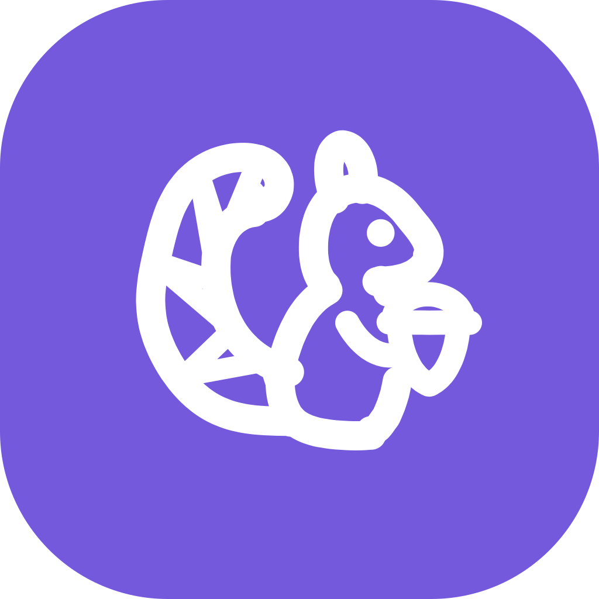

<p align="center">
  
</p>

<h1 align="center">다람이 (darami)</h1>

<p align="center"><b>폰에 적어 두면, 다람이가 내 위키에 정리합니다.</b></p>

<p align="center">
  <a href="https://github.com/hseunghwan/darami/releases/latest">다운로드</a> ·
  <a href="docs/guide.ko.md">안내서</a> ·
  <a href="README.md">English</a>
</p>

다람이는 안드로이드 폰에서 쓴 메모와 공유한 링크, 사진을 Markdown 위키에 정리하는 앱입니다. 내 ChatGPT 계정으로 로그인하면, ChatGPT가 메모를 분류하고 위키 페이지에 반영합니다.

위키는 폰 안의 폴더에 저장됩니다. Obsidian으로 열거나 Syncthing으로 동기화할 수 있고, 별도 서버나 컴퓨터 없이 사용할 수 있습니다.

## 주요 기능

1. **메모 입력:** 앱에서 메모를 쓰거나 다른 앱의 글, 링크, 사진을 공유합니다.
2. **위키 정리:** 일상, 스터디, 미루기 아카이빙 등의 도메인으로 분류하고 해당 페이지를 수정합니다. 직접 추가한 도메인도 사용할 수 있습니다. 링크의 본문을 읽고, 사진의 촬영 시각과 장소도 기록합니다.
3. **질문:** 위키 내용을 바탕으로 답하고, 참고한 페이지를 함께 보여 줍니다. 답변을 위키 페이지로 저장할 수도 있습니다.

## 파일과 설정

- 위키는 사용자가 선택한 폴더에 Markdown 파일로 저장됩니다. 다람이 전용 서버나 계정은 없습니다.
- 기존 ChatGPT 구독을 사용합니다. 설정에서 정리와 질문에 사용할 모델과 추론 강도를 각각 고를 수 있습니다.
- 메모를 폴더에 저장한 뒤 입력창을 비웁니다. 정리 결과가 위키 규칙을 어기면 변경을 되돌리고 다시 시도합니다.
- 설정에서 도메인을 추가하거나 페이지 종류를 바꿀 수 있습니다. `dotoriwiki.yaml`에는 수정한 줄만 반영합니다.

## 시작하기

1. [Releases](https://github.com/hseunghwan/darami/releases/latest)에서 APK를 받아 폰에서 엽니다.
2. 일회용 코드로 ChatGPT에 로그인합니다.
3. Documents 하위 폴더 등 비어 있는 폴더를 고릅니다. 다람이가 폰의 언어 설정에 맞춰 기본 위키를 만듭니다.

설정이 끝나면 메모를 쓸 수 있습니다. 자세한 사용법은 [안내서](docs/guide.ko.md)를 참고하세요.

## 알아 두세요

- 안드로이드 전용입니다. 다람이는 앱이 화면에 열려 있을 때 메모를 정리합니다.
- 정리와 질문은 ChatGPT 요금제의 사용 한도에 포함됩니다.
- 다람이는 Codex 앱과 같은 방식으로 로그인하고 Codex 엔드포인트를 호출합니다. ChatGPT 로그인을 사용하는 서드파티 앱에 대한 OpenAI의 공개 정책은 없으며, 엔드포인트가 바뀌면 앱이 동작하지 않을 수 있습니다. 개인 용도로 만든 앱입니다.
- 메모 내용, 모델이 읽는 페이지, 1024 px로 줄인 사진이 OpenAI로 전송됩니다. 전체 목록은 [폰 밖으로 나가는 것](docs/guide.ko.md#폰-밖으로-나가는-것)에 있습니다.

## dotoriwiki와의 관계

다람이는 [dotoriwiki](https://github.com/hseunghwan/dotoriwiki)를 바탕으로 만들었습니다. dotoriwiki는 컴퓨터의 게이트웨이에서 메모를 위키로 정리합니다. 두 앱은 같은 위키 형식을 사용하므로 서로의 위키를 그대로 열 수 있습니다.

## 소스에서 빌드하기

```sh
npm ci
npm run typecheck
npm test
```

APK 빌드와 서명 방법, 디버그 화면에 대한 설명은 [안내서](docs/guide.ko.md#소스에서-빌드하기)에 있습니다.

## 라이선스

MIT. [LICENSE](LICENSE)를 보세요.
