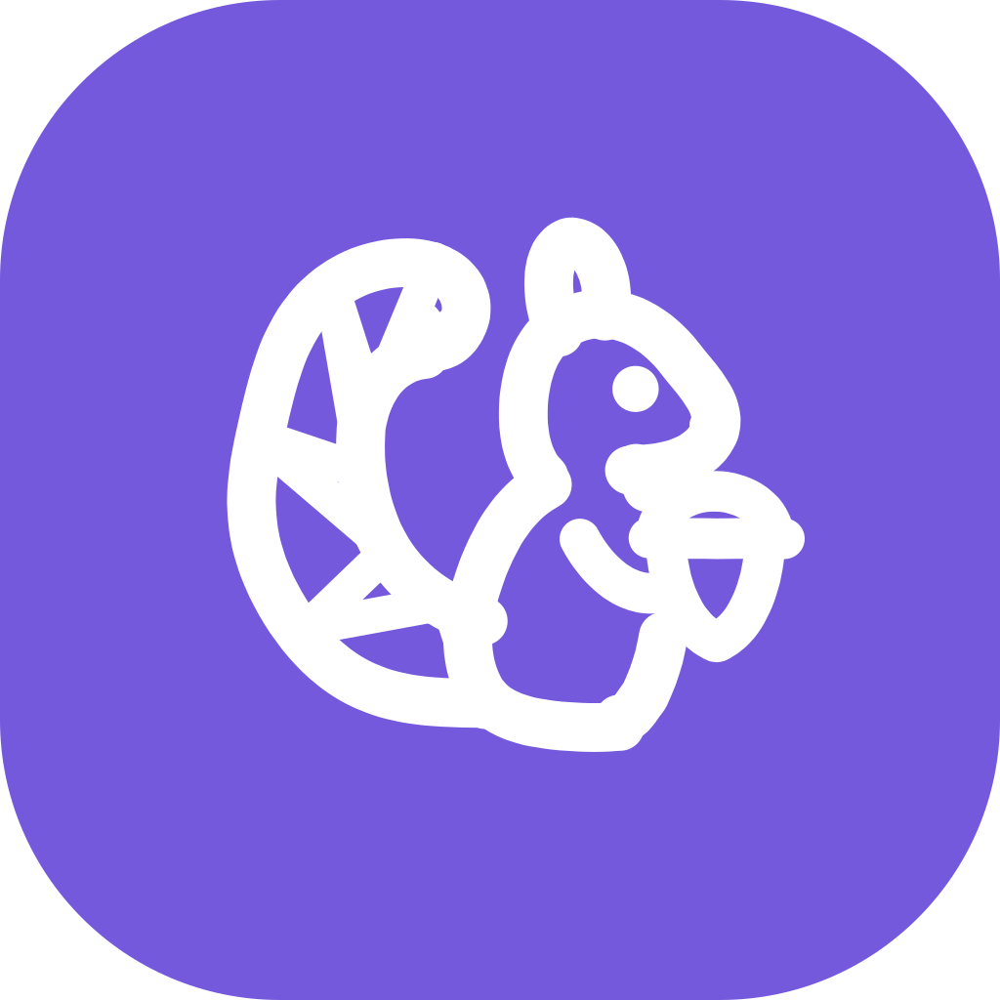

<p align="center">
  
</p>

<h1 align="center">darami</h1>

<p align="center">
  <a href="README.ko.md">한국어</a>
</p>

**Jot a line on your Android phone. darami files it into your own wiki, on the phone.**

darami is for people who write things down in a hurry and never sort them. You type a line, share a link, or attach a photo. darami logs in to ChatGPT with your account, asks the model which domain of your wiki the memo belongs to, and has the model file it into that domain's Markdown pages. The wiki is a folder on the phone, so Obsidian and Syncthing can open the same folder. No server or computer takes part.

The name is 다람이, Korean for a little squirrel. darami grew out of [dotoriwiki](https://github.com/hseunghwan/dotoriwiki), which runs the same job on a gateway on your computer, and it keeps dotoriwiki's wiki format.

> **For personal use.** darami signs in the way the Codex app does. It uses Codex's device-code login and calls the Codex endpoint, `chatgpt.com/backend-api/codex`, with your ChatGPT account, so filing and questions count against your plan's usage limit. OpenAI has published no policy for third-party apps that use a ChatGPT login. darami can stop working whenever OpenAI changes the endpoint.

## Install the app

1. On the phone, download the APK from [Releases](https://github.com/hseunghwan/darami/releases). CI attaches the APK to every tag that starts with `v`. Each push to `main` also leaves one as an artifact of the [app workflow](https://github.com/hseunghwan/darami/actions/workflows/app.yml).
2. Open the APK. Android asks you to allow installs from the app that opened it.

The file name ends in `-signed` when CI signed it with the release key, and in `-debug-signed` when no key was set up. Android refuses an update signed with a different key than the installed app. To install an APK signed with a different key, uninstall darami first. That deletes the login and the chat history on the phone. The wiki folder stays.

Releases from this repository are signed with darami's release key. Its certificate's SHA-256 fingerprint is `72:1A:4C:09:BF:5F:F8:00:B8:8C:FB:BC:2E:47:64:17:7E:4B:19:80:58:15:56:50:8D:B5:99:C5:63:52:26:C3`. `apksigner verify --print-certs <apk>` prints the fingerprint of an APK you downloaded. A different fingerprint means someone else built it.

## Set it up

The first run has four steps.

1. **Log in to ChatGPT.** Tap **Get a login code**. Tap **Copy code**, then **Open the ChatGPT page**, and type the code there. The code works for 15 minutes. Once ChatGPT approves it, the app shows your account. Tap **Next**.
   A personal account may have device-code login turned off. The app then says so. Turn it on in ChatGPT's security settings, then tap **Get a new code**.
2. **Pick the wiki folder.** Tap **Pick a folder**, and pick or make a folder in Android's folder picker. Only folders on the phone's own storage work, such as one under `Documents`. A folder from another provider, such as a cloud drive, is refused.
   - An empty folder gets a starter wiki in the phone's language, Korean on a Korean phone and English otherwise. Tap **Start a wiki here**, then **Use this folder**. The English wiki has the domains `journal`, `learning`, and `someday`, and takes the phone's time zone.
   - A folder with a wiki opens as it is, one that dotoriwiki made included. Tap **Use this folder**.
   - A folder with other files is refused. Names that start with a dot, such as `.stfolder` and `.obsidian`, do not count, so a new Syncthing folder is empty.
3. **Location.** Tap **Allow location** to keep where you wrote each memo, or **Not now**. You can take the location off any one memo, and turn it off in Settings.
4. Tap **Write your first memo**.

## Write memos

The **Memo** tab opens on the text box. Write a line and tap **Send**. darami saves the memo in the folder's `inbox/` before the box clears, so a crash or a dead network loses nothing.

Under the box, **Where should it go?** lists **Auto** and each domain. With **Auto**, the classifier picks the domain. A domain chip sends the memo straight to that domain, and the classifier is not asked.

**Just sent** lists your last ten memos with their state: Received, Queued, Filing, Filed, Needs you, or Failed. Tap a memo for its progress and the pages it changed. Tap a changed page to read it.

### Send from other apps

Share text, a link, or photos from another app to darami, or select text and pick darami in the selection menu. The **Save to wiki** sheet opens. Add a line under **Add a line (optional)** if you like, pick a domain, and tap **Save**. darami closes once the memo is in the folder. It files the memo the next time you open the app.

### Photos and links

Tap **Choose photos** or **Take a photo** to attach up to 10 photos. A photo alone is a memo. darami keeps the original in `_originals/`, writes a copy of at most 2048 px to `_attachments/` for pages to embed, and shows the model a 1024 px copy. The memo records when and where each photo was taken, from its EXIF.

When a memo is filed, the phone fetches up to three of its links and extracts each article's text into `raw/<id>.source.md`, which the model reads. A YouTube link is recorded as not fetched, because darami has no transcript reader.

### Confirm a held memo

When the classifier's confidence is under 0.6, or it cannot pick at all, the memo waits in a domain's `hold/` folder. **Activity** shows it under **Needs your check** with the classifier's guess.

- **Correct** files it in the guessed domain.
- **Somewhere else** opens **Move it where?**. Pick a domain and tap **Move**. That domain files the memo from the start.

### Failed memos

darami checks each filing before it keeps it. The model can write only `.md` pages under the memo's own `<domain>/wiki/`. A write anywhere else, a page missing a frontmatter field, or a link to a page that does not exist fails the attempt, and darami undoes every change the attempt made. It tries again 30 seconds after the first failure and a minute after the second. After three tries, **Activity** shows the memo as failed with the reason. Tap **Try again** for three more tries, or open the memo and tap **Move to another domain**.

### When filing waits

Trouble with the network, the login, or ChatGPT spends no try. The memos wait in the folder, and the badge next to the settings button says why.

| Badge | Meaning |
| --- | --- |
| `Offline` | No network. Memos wait and are filed once the network is back. |
| `Usage limit until 3:12 PM` | The plan's usage limit is reached. Filing starts again at that time. |
| `ChatGPT isn't answering` | The server failed, or the stream stalled for 2 minutes. darami tries again in 2 minutes, or in 10 when the account cannot use the model. |
| `Log in again` | The login expired. Tap the badge to log in. |
| `Wiki folder needs you` | The folder was moved or access to it was taken away, or `dotoriwiki.yaml` has a mistake. |

darami files only while it is open on screen. Leaving the app stops the job that is running and undoes it without spending a try. Filing starts again when you come back. After a network or server problem, **File now** in Settings tries again at once instead of waiting.

## Ask your wiki

The **Ask** tab answers questions from your wiki. Pick **All** to ask across every domain, or a domain chip to ask one. The model reads `index.md` and the pages it needs, and the app shows which pages it is reading. Asking changes no file.

- The answer cites pages as chips. Tap a chip, or a link in the answer, to open the page in a read-only viewer with its photos.
- **Save answer** files the answer as a page in `<domain>/wiki/answers/`, through the same checks as a memo. A domain chat saves into its domain. A chat across all domains saves into the domain of the first page it cites, so an answer that cites no page cannot be saved. Once the answer is saved, the button reads **Saved** and opens the page.
- **Remember**, under your question, files the question as a memo. Use it for something you tell the wiki, such as "I watched that video".
- **Copy** copies the answer.

Chats stay on the phone, outside the wiki folder. The history button opens **Past chats**, and the plus button starts a new chat. A question that needs more than 10 model turns or 3 minutes stops and asks for a narrower question.

## Pick the models

Settings has a **Model** section with two rows. **Filing** sorts memos and writes the pages. **Ask** answers your questions. Each row shows the model and effort in use, such as `gpt-6-sol · high`, or **Default (gpt-6-luna)**.

Tap a row to change it. The sheet lists **Default (gpt-6-luna)** and the models your ChatGPT plan offers. Pick a model, then its effort. When ChatGPT names the efforts a model takes, the sheet offers only those, and a saved effort the model no longer takes runs at the model's default. Higher effort takes longer and uses more of your plan's limit. **Default** puts the row back on `gpt-6-luna`, with low effort to sort memos and to answer, and medium to file.

darami asks ChatGPT for the list each time Settings opens and keeps the last one, so the sheet works offline. A pick applies from the next model call. When the account cannot use the model, the badge reads `ChatGPT isn't answering` and darami tries again in 10 minutes, or at once when you pick another model. The **Filing** pick wins over a `model_profile` in `dotoriwiki.yaml`.

## Change domains

In Settings, under **Wiki folder**, tap **Change domains**. The list shows each domain with its description, and the domain where unsure memos go.

- Tap a domain to change its description or its page types. Add a type, change a type's description or example, or remove a type, then tap **Save** to write them together. A type's name cannot change once saved, and a domain keeps at least one type.
- Tap **Add a domain** to make one. Give it a folder name, a one-line description, and at least one page type. darami writes the domain's `CLAUDE.md` with the common rules and your description, then adds the domain to `dotoriwiki.yaml`. If the wiki already has a folder with exactly that name, darami uses it and keeps its files and its `CLAUDE.md`.
- Tap **Unsure memos** to pick the domain a memo goes to when the classifier cannot choose.

The classifier routes by each domain's description. The routing rules in the root `CLAUDE.md` name only the domains they were written for, so darami tells the classifier which domains those rules leave out, and asks it to check them before it falls back to the rule for memos that fit nowhere.

darami applies a change to `dotoriwiki.yaml` as the file is when you tap **Save**. It rewrites only the lines of the change, and keeps your comments, key order, indent, and the keys it does not use. A change you made in Obsidian to another domain stays. If the same domain changed since you opened it, darami saves nothing and offers **Reload**. If the app is killed while it writes `dotoriwiki.yaml`, darami finishes that write the next time it reads the folder, so the file is never left half written.

To rename or delete a domain, or to change what its `CLAUDE.md` says, edit the files yourself, as [Edit pages in Obsidian](#edit-pages-in-obsidian) describes.

## The wiki folder

```
dotoriwiki.yaml       the wiki's settings: locale, time zone, fallback domain, domains, page types
CLAUDE.md             what the wiki is for. The classifier reads it.
_schema/              rules that every domain's CLAUDE.md includes
inbox/                memos not yet routed. inbox/answers/<domain>/ holds answers waiting to be saved.
<domain>/
  CLAUDE.md           what the domain is for and how to file into it
  raw/                the domain's memos as <id>.md, and <id>.source.md with the text of their links
  hold/               memos waiting for you to confirm the domain
  wiki/               the pages
    index.md          one line per page, built from each page's frontmatter
    log.md            the ledger, one line for each filing, failed attempt, retry, and move
    _review.md        judgment calls the model left for you
    answers/          answers saved from Ask
_originals/           photos as the phone sent them, EXIF and GPS included
_attachments/         copies of at most 2048 px that pages embed as ![[<id>-1.jpg]]
```

darami writes the memo files, the photo files, `index.md`, and `log.md`. The model writes pages only under the memo's own `<domain>/wiki/`. It may only add lines to the end of `_review.md`, and it has no tool to delete a file. After darami writes the starter wiki, it writes `dotoriwiki.yaml` only when you change domains in Settings, and then only the lines of that change. It writes a `CLAUDE.md` only for a domain you add there, and never changes one you wrote or anything in `_schema/`. It skips every name that starts with a dot. There is no git. Each domain's `log.md` is the record.

### Edit pages in Obsidian

Open the folder as an Obsidian vault and edit any page. darami reads pages from the folder for every job and every question, so it works from your edits. If a page changes while a job is working on it, the model has to read the page again before it can write it. Keep each page's frontmatter (`type`, `summary`, `aliases`, `status`, `sources`, `updated`), because `index.md` is built from it.

You can also edit `dotoriwiki.yaml` and the `CLAUDE.md` files yourself. That is the way to rename or delete a domain, or to change what a domain's `CLAUDE.md` tells the model. To rename a domain, rename its folder and its key under `domains` together. darami reads the file on every pass, so a saved change applies without a restart. A mistake in the file pauses filing while memos keep arriving. **Change folder** in Settings lists each problem with its fix, and **Check again** reads the file again.

### Sync with Syncthing

Share the wiki folder with Syncthing to get a copy on your computer. Before you do, know what it carries. `_originals/` holds every photo as the phone sent it, GPS included, and memo files in `raw/` record where you were when location is on. The copies in `_attachments/` carry no EXIF. To keep the originals on the phone, add `_originals` to the folder's `.stignore`.

### Use it with dotoriwiki

A darami wiki and a dotoriwiki wiki are the same format, `dotoriwiki.yaml` included. darami opens a wiki that dotoriwiki made as it is, with its held memos and saved answers. `src/jobs/__tests__/replay.test.ts` runs a dotoriwiki wiki's memos through darami's engine with a fake model and gets the same files byte for byte. dotoriwiki's gateway needs a git repository, so run `git init -b main` in a darami folder before you point dotoriwiki at it. darami reads but ignores the `feeds` and `agents_may_read` keys, because it has no feeds and no coding-agent memos.

## What leaves the phone

darami has no server of its own. These leave the phone:

- The login, to `auth.openai.com`.
- To the Codex endpoint, under your ChatGPT account:
  - each memo's text, and the memo file with its location and photo details when they are there
  - the pages, `CLAUDE.md` files, and `dotoriwiki.yaml` that the model reads while it files a memo or answers a question
  - each photo, as a 1024 px JPEG
  - the article text fetched from a memo's links
  - your questions, with the earlier answers in the same chat
- Requests to the sites a memo links to. The phone fetches each link itself, with a desktop browser's user agent.
- When location is on, the position and each photo's GPS go to Android's geocoder, which names the place. Android's geocoder usually looks the place up over the network.

darami copies the wiki folder nowhere, so the folder and the photo originals in it stay on the phone unless you sync them. The login tokens stay in Android's secure storage, and the chat history stays in the app's own database.

## Limits

- Android only.
- One wiki folder at a time. **Change folder** in Settings switches it.
- Only folders on the phone's own storage work. SD cards were not tested.
- Filing runs only while darami is open on screen.
- YouTube links are not transcribed. There are no feeds.
- Every job runs on `gpt-6-luna` until you pick other models in Settings, as [Pick the models](#pick-the-models) describes. Only `gpt-6-luna` was timed on the phone. A `model_profile` other than `default` in `dotoriwiki.yaml` gets a warning and changes nothing. In the checks so far, `gpt-6-luna` at medium effort filed three short memos as **Nothing to file**.
- A usage limit pauses filing until the time ChatGPT gives, or for five minutes when it gives none. That path has not met a real limit yet.
- A large wiki is slow. Every read goes through Android's storage framework, and search reads every page.

[docs/plan.md](docs/plan.md) records the design and what each phase found on the emulator.

## Build from source

You need Node 24, the version CI uses, with the npm it ships. For the APK you also need JDK 17 and the Android SDK, with `ANDROID_HOME` set. On Windows, clone with `core.autocrlf=false`. With `true`, git writes CRLF into `presets/` and the test fixtures, and their bytes no longer match the repository.

```sh
npm ci
npm run typecheck
npm test
```

`npm run typecheck` runs `tsc` on `tsconfig.app.json`, the code the phone ships, and then on the whole repository. `npm test` runs jest with `TZ=Asia/Seoul`.

To build the release APK:

```sh
npx expo prebuild --platform android --no-install
cd android
./gradlew assembleRelease -PreactNativeArchitectures=arm64-v8a,x86_64
```

The APK is `android/app/build/outputs/apk/release/app-release.apk`. `scripts/release.sh` does the same for `arm64-v8a` and prints the path and the sha256. With `--install`, it also installs the APK over adb and starts it.

### Sign it

To sign with your own key, write `keystore/keystore.properties` with `storeFile`, `storePassword`, `keyAlias`, and `keyPassword`. `/keystore/` is gitignored. Without that file, the release build carries the debug key.

In CI, set the repository secrets `ANDROID_KEYSTORE_BASE64`, `ANDROID_KEYSTORE_PASSWORD`, `ANDROID_KEY_ALIAS`, and `ANDROID_KEY_PASSWORD`. Without them, CI warns and names the APK `-debug-signed`. The repository variables `DARAMI_APP_ID` and `DARAMI_APP_NAME` set the package id and the launcher name, which default to `dev.darami.app` and Darami, or 다람이 on a Korean phone. A build with its own package id installs next to the default one.

### Check screens

A debug build loads its JavaScript from Metro. `npx expo run:android` builds and installs one, and `npm start` starts Metro. Three screens open only in a debug build. A release build sends them to the memo tab. Each writes its lines to logcat under `ReactNativeJS`.

| Link | What it runs | Log prefix |
| --- | --- | --- |
| `darami://fs-check` | The Fs contract in `src/fs/contract.ts` on SAF, in a folder you pick | `FSCHECK` |
| `darami://photo-check` | exifr, the photo copies, and the link reader on Hermes | `PHOTOCHECK` |
| `darami://engine-check?text=<percent-encoded>` | Files one memo through the engine on the kept folder and login. `&hint=<domain>` picks the domain. | `ENGINE` |

Open one with `scripts/emu.py open darami://fs-check`, or with `adb shell am start -a android.intent.action.VIEW -d darami://fs-check dev.darami.app`.

## License

MIT. See [LICENSE](LICENSE).
